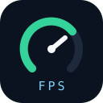
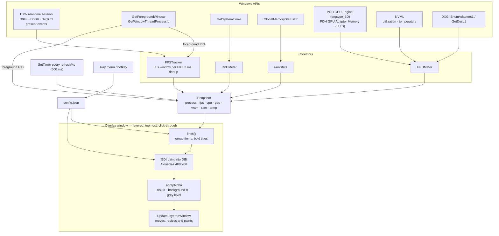

#  Open Perf HUD  

[](https://github.com/Icaruk/open-perf-hud/releases/latest)
[](https://github.com/Icaruk/open-perf-hud)
[](https://go.dev)

FPS, CPU, GPU, VRAM and RAM in a small always-on-top overlay for your games. One `.exe`, nothing else to install.


## [⬇ Download latest release](https://github.com/Icaruk/open-perf-hud/releases/download/v1.0.0/open-perf-hud.exe)

## Why this one

- **One `.exe`, nothing else:** no installer, no background service (it only runs while exe is open), no runtime to keep updated. Delete the file and it's gone.
- **No injection, no hooks:** it listens to the frame events Windows already emits (the same source as Intel's PresentMon). Nothing is written into the game's memory so anti-cheat has nothing to flag.
- **Light:** single 3.87 MB executable, no dependencies.
- **Configurable from the tray:** position, size, colors and metrics in a click. File `config.json` sits next to the exe.
- **Scriptable:** `--cli` prints the same numbers to the console. `--probe` diagnoses FPS issues.

## Requirements

- **Windows 10 or 11, 64-bit.**
- **Nothing to install**: a single `.exe`. No RTSS, no Afterburner, no extra tool running in the background.
- **Any graphics card** (NVIDIA, AMD or Intel). GPU temperature is NVIDIA-only; on other cards it shows `n/d`.
- **Borderless windowed**, not exclusive fullscreen (see [limitations](#known-limitations)).
- **Administrator**: Windows may ask for permission once. Say yes for frame rate; if you say no, everything except FPS keeps working.

## Usage

1. Download `open-perf-hud.exe` and run it. It goes to the system tray and starts drawing the overlay.
2. Start your game in borderless windowed mode.
3. Right-click the **tray icon** to move it, resize the text, change colours, or pick which metrics you see.

- The overlay is click-through and always on top: it never takes clicks from the game.
- It follows the screen of the game window you have focused.
- Hotkey `CTRL+SHIFT+O` (configurable) hides and shows it.
- Launching it again asks **Retry** (close the running one) or **Cancel** (keep it).
- FPS is the frame rate of the app you have focused. On the desktop, or in apps that draw frames from a separate process (browsers), it shows `—`.

## Settings

Everything is in the tray menu, and saved to `config.json` next to the exe:

| Menu | What it changes |
|---|---|
| Metrics | which values are shown (name, FPS, CPU, GPU, GPU temp, VRAM %, VRAM GB, RAM %, RAM GB) |
| Position | which corner of the screen |
| Text size | `xs` · `sm` · `md` · `lg` |
| Text color | 9 greys from White to Black (`Grey` and `Grey-dark 1` match Steam's overlay) |
| Background | opacity of the black box behind the text, 0–100 % |
| Layout | one metric per line, or all on one line |
| Margin | distance from the screen edge |
| Inner margin | padding inside the box |
| Item spacing | gap between items, `none` packs them tight |
| Offset left / right / top / bottom | extra pixels from each edge, 0–50 |

Consecutive metrics of the same kind share their label (`GPU 10% · 64 °C | CPU 10%`), and the labels are bold.

## Config file

`config.json` next to the exe (created with defaults on the first menu change):

```json
{
  "corner": 1,
  "margin": "none",
  "opacity": 180,
  "fontSize": "sm",
  "orientation": "horizontal",
  "bgOpacity": 25,
  "textColor": "White-grey 2",
  "innerMargin": "none",
  "spacing": "xs",
  "offsetLeft": "none",
  "offsetRight": "none",
  "offsetTop": "none",
  "offsetBottom": "none",
  "metrics": {
    "name": false, "fps": true, "cpuPct": true, "gpuPct": true, "gpuTemp": true,
    "vramPct": true, "vramGB": true, "ramPct": true, "ramGB": true
  },
  "refreshMs": 500,
  "hotkey": "CTRL+SHIFT+O"
}
```

- `corner`: 0 top-left · 1 top-right · 2 bottom-left · 3 bottom-right.
- `opacity`: 0–255 (text).
- `bgOpacity`: 0–100 (% of the black background; 0 = text only).
- `textColor`: `White|White-grey 1..3|Grey|Grey-dark 1..2|Grey-black|Black` — text grayscale (255/224/198/171/158/138/110/74/0); `Grey` and `Grey-dark 1` are Steam's greys (9e9e9e/8a8a8a).
- `innerMargin`: `none|xs|sm|md|lg` (inner padding).
- `spacing`: `none|xs|sm|md|lg|xl` (0/2/5/8/12/20 px between items; the step is based on font size, not the GDI cell, so it is properly compact; in horizontal layout it scales the `·` separator; `none` = no spaces at all).
- `fontSize`: `xs|sm|md|lg` (12/15/18/24 px).
- `margin`: `none|xs|sm|md|lg` (0/4/8/12/24 px).
- `offsetLeft|offsetRight|offsetTop|offsetBottom`: `none|2|4|8|10|12|14|16|20|24|30|40|50` px extra from each edge on top of `margin` (they push the overlay inwards from that edge; combinable).
- `orientation`: `vertical` (one metric per line) or `horizontal` (everything on one line).
- `metrics`: one boolean per metric; VRAM and RAM merge `%` and GB when both are on (`VRAM 35% 8.8/9.8 GB`).
- `refreshMs`: how often the overlay updates (500 = twice per second).
- `hotkey`: any combination of `CTRL`/`SHIFT`/`ALT` and a key, e.g. `CTRL+SHIFT+O`; empty disables it.

Command line (for scripting and bug reports):

| Command | What it does |
|---|---|
| `open-perf-hud.exe` | The overlay. |
| `open-perf-hud.exe --cli` | Same metrics, printed to the console, no overlay and no admin prompt. |
| `open-perf-hud.exe --probe 10s` | Diagnostic histogram of the frame-rate events received. Useful when FPS shows `—`. |

## FAQ

**Is it safe with anti-cheat?**  
Yes — it never injects code or reads the game's memory. It only listens to the frame events Windows itself broadcasts (see [Why this one](#why-this-one)).

**Why does it ask for administrator permission?**  
Only the FPS counter needs it. Say no and everything except FPS keeps working.

**Why does my game need borderless windowed?**  
In exclusive fullscreen no app can draw over the game — that's a Windows rule, not a limitation of this tool. Borderless windowed looks identical and allows overlays.

**FPS shows `—`?**  
Expected on the desktop and in browsers (they don't count as the focused app). If it happens in a Vulkan/OpenGL game on Windows 11, run `open-perf-hud.exe --probe 10s` with the game focused — see [limitations](#known-limitations).

**Where is the CPU temperature?**  
Windows doesn't expose it without a kernel driver, and this tool refuses to install one on purpose.

## Known limitations

- **Exclusive fullscreen**: not supported (a window cannot draw over exclusive mode). Use borderless windowed. This is why other overlays inject DLLs into the game; this app injects nothing.
- **GPU%**: NVML (NVIDIA) when available — the same number Steam and the NVIDIA panel show. Otherwise PDH "GPU Engine" counters, which read lower under load.
- **FPS**: captures Present events from DXGI, D3D9 and DxgKrnl (PresentHistory) — covers DXGI/D3D9 windowed and borderless. **Vulkan/OpenGL may not be counted on Windows 11**: some builds do not emit DxgKrnl's PresentHistory_Start (0xAB). If a Vulkan game shows `—`, run `--probe 10s` with it in the foreground to see which event IDs DxgKrnl emits.
- **CPU temperature**: not available without a kernel driver, so it is out of scope by design (no driver, no reboot).

## Development

Requires Go 1.26+ and [Task](https://taskfile.dev). `task build` (runs `go fix` first, then both exes), `task check` (gofmt/vet/test), `task smoke` (overlay for 6s + CLI for 4s), `task modernize` (`go fix`, standalone), `task run`, `task cli`, `task probe -- 10s`, `task clean`, `task icon` (regenerates icon.ico + rsrc.syso from the icon.svg design; requires `go install github.com/akavel/rsrc@latest`).

Platform: Win32 + ETW + PDH + DXGI + NVML, all through `syscall`/`golang.org/x/sys/windows` — no cgo, no third-party packages in the binary.

## Architecture



FPS comes from ETW presents attributed to the foreground PID (no injection); GPU% prefers NVML because it matches what Steam and the NVIDIA panel report; everything else is a direct kernel32 / PDH / DXGI call. Only the ETW session can need admin.

## How it works

- **FPS**: real-time ETW session subscribed to Microsoft-Windows-DXGI, -D3D9 and -DxgKrnl, filtered by event ID to the present events that are actually emitted (DXGI Present_Stop / PresentMultiplaneOverlay_Stop, D3D9 Present_Stop, DxgKrnl PresentHistory_Start / PresentHistoryDetailed_Start). One-second sliding counter per PID; PID = process owning the foreground window. Pairs reported by both runtime and kernel are deduplicated within 2 ms.
- **CPU**: `GetSystemTimes` (kernel32). **RAM**: `GlobalMemoryStatusEx`. **GPU**: NVML utilization, falling back to PDH `\GPU Engine(*engtype_3D)\Utilization Percentage`.
- **VRAM**: used = PDH `\GPU Adapter Memory(*)\Dedicated Usage` filtered by the main adapter LUID; total = DXGI `EnumAdapters1`/`GetDesc1`. The DXGI desc is parsed by validation because two layouts exist in the wild (with and without the `Flags` field, verified empirically).
- **Overlay**: Win32 layered + topmost + click-through window, painted with GDI (Consolas), pushed with `UpdateLayeredWindow` and per-pixel alpha so text and background have independent opacity.
